# Cotton 2 English (Sega ST-V)

An English translation of the ST-V arcade game *Cotton 2* (Success, 1997,
MAME set `cotton2`), as a bootleg clone set `cotton2e` for
[mame2003-plus](https://github.com/zanac/mame2003-plus-libretro)
(branch `stv-cotton2-english`).

The arcade game has no English text in its story scenes: the dialogue,
the hints on the continue screen, the prologue and the character
profiles are Japanese graphics. The Saturn port of the game has an
English fan translation. This project takes the translated graphics from
the Saturn files and puts them into the arcade cartridge.

## Status

| Part | State |
|---|---|
| Attract mode: prologue scroll, character profiles | English, checked in the emulator |
| Continue screen hints, all 7 stages | English, checked in the emulator (stages 1–2) |
| Story scenes VS0–VS6 | English, checked in the emulator |
| Ending VS7 and staff roll | English, checked in the emulator |
| ROM set `cotton2e`, patch, driver entry | done |

Known differences and limits:

- The staff roll keeps the Saturn translators' credit and adds the line
  "Ported by Zanac" after it; the two helpers' lines are joined in one
  ("with help from Katrin & Danthrax") to make room.
- The Saturn overlays also play the text blip sound every other frame and
  change a loop limit in the ending (75 → 80). The arcade code is a
  different build and these two changes are not ported.
- `CHR_INF.MF` and `CHR_VS70.MF` (Saturn only) have no arcade counterpart.

## Screenshots

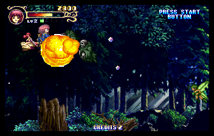

*Stage 1 in `cotton2e`.*

Translated screens: Japanese arcade original on the left, `cotton2e` on
the right.

| | |
|---|---|
| Prologue | 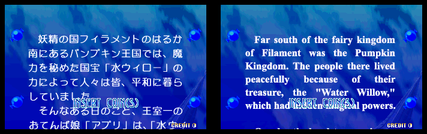 |
| Profiles: Cotton, Silk | 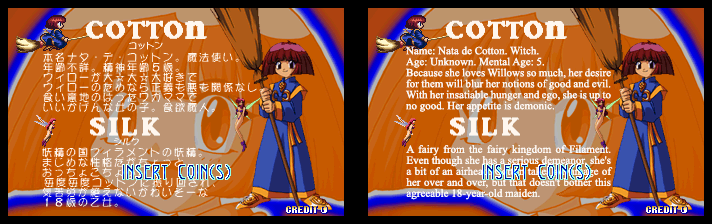 |
| Profiles: Appli, Needle | 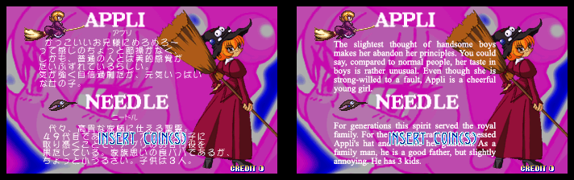 |
| Continue screen, stage 1 | 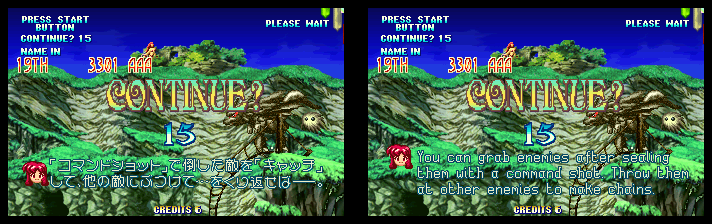 |
| Continue screen, boss | 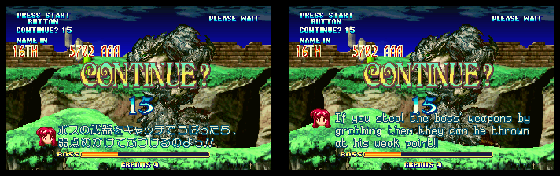 |
| Opening scene | 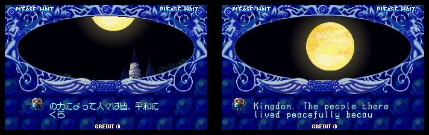 |
| Story scene | 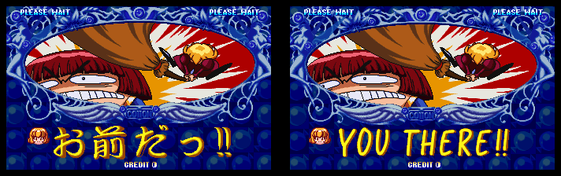 |
| Story scene | 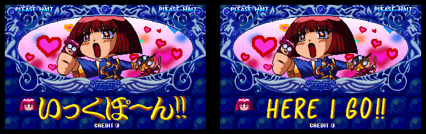 |
| Scene before the last boss | 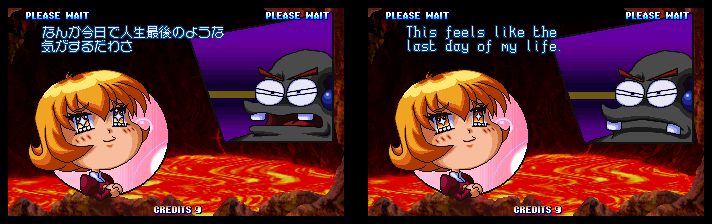 |
| Ending | 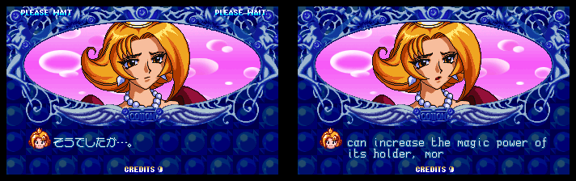 |
| Staff roll | 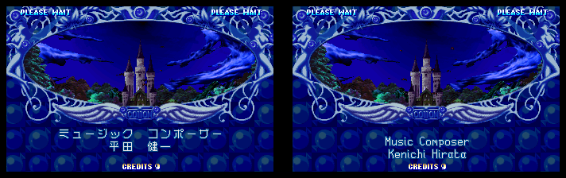 |

The translators' credit in the staff roll, followed by the arcade port:

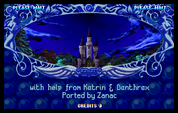

## Getting the ROM set

You need `cotton2.zip` (the MAME set) and `stvbios.zip`.

```
python3 patch/make_cotton2e.py ROMDIR [OUTDIR]
```

This writes `cotton2e.zip`. Python 3, standard library only. The script
checks every file it writes against the CRC32 in the patch.

Input, from `cotton2.zip` (found by CRC, the names inside the zip do not
matter):

| File | Size | CRC32 | SHA1 |
|---|---|---|---|
| mpr20122.7 | 2097152 | d616f78a | 8039dcdfdafb8327a19a1da46a67c0b3f7eee53a |
| mpr20117.2 | 4194304 | 893656ea | 11e3160083ba018fbd588f07061a4e55c1efbebb |
| mpr20118.3 | 4194304 | 1b6a1d4c | 6b234d6b2d24df7f6d400a56698c0af2f78ce0e7 |
| mpr20119.4 | 4194304 | 5a76e72b | 0a058627ddf78a0bcdaba328a58712419f24e33b |
| mpr20120.5 | 4194304 | 7113dd7b | f86add67c4e1349a9b9ebcd0145a30b1667df811 |
| mpr20121.6 | 4194304 | 8c8fd521 | c715681330b5ed37a8506ac58ee2143baa721206 |
| mpr20116.1 | 4194304 | d30b0175 | 2da5c3c02d68b8324948a8cdc93946d97fccdd8f |
| mpr20123.8 | 4194304 | 35f1b89f | 1d6007c380f817def734fc3030d4fe56df4a15be |

Output, the files of `cotton2e.zip` after the patch:

| File | Size | CRC32 | SHA1 | Replaces |
|---|---|---|---|---|
| c2e20122.7 | 2097152 | 0b9d225c | 074777cf0d681e334ec7d3819a4e9cd86e258ad1 | mpr20122.7 |
| c2e20117.2 | 4194304 | b6e0e634 | cad580d39a7bf666c55794d28788cb0f6503155d | mpr20117.2 |
| c2e20118.3 | 4194304 | 645ab039 | 648b883451e08efc0ce3383e3af95472ad05fd77 | mpr20118.3 |
| c2e20119.4 | 4194304 | c7e0165e | 918df5f590c968370f9df7209dd1c5f3e97157c9 | mpr20119.4 |
| c2e20120.5 | 4194304 | 988121dd | 176badb58896cecb5f5c9f31ed9e6fa096aef03f | mpr20120.5 |
| c2e20121.6 | 4194304 | b1b67426 | 9bde1f45f758b70c1c7de61b8eb8e555f2170e66 | mpr20121.6 |
| c2e20116.1 | 4194304 | 65207eb8 | e0cbde50ceaf3c8c7162d2e708b0241887166d9a | mpr20116.1 |
| c2e20123.8 | 4194304 | c33662ba | fd44fadf41fdde1ba11bd477500bdfe09b066fbf | mpr20123.8 |

The `c2e*` names are the ones the `cotton2e` driver entry in
mame2003-plus expects; all eight chips change. The BIOS comes from
`stvbios.zip`, as for `cotton2`.

## Rebuilding everything

`build.py` redoes the whole job from the original material and writes
both the ROM set and `patch/cotton2e.dat`:

```
python3 build.py ROMDIR DISC PATCH [OUTDIR]
```

- `ROMDIR`: folder with `cotton2.zip`
- `DISC`: the Japanese Saturn disc of *Magical Night Dreams: Cotton 2*
  (`.cue`, Track 1 `.bin` or an `.iso` of the data track)
- `PATCH`: `ss_cotton_2_eng_v0.9.zip`, the Saturn English patch (in
  `saturn-patch/`), or the `.SSP` inside it

Example:

```
python3 build.py roms "Magical Night Dreams Cotton 2 (Japan).cue" saturn-patch/ss_cotton_2_eng_v0.9.zip out
```

Steps:

1. rebuild the 26 English Saturn files (`out/saturn/orig`, `out/saturn/eng`)
2. check the Saturn → arcade converter against the cartridge
3. build the English cartridge
4. write `out/cotton2e.zip` and `patch/cotton2e.dat`

The result is reproducible byte for byte.

| Script | Purpose |
|---|---|
| `build.py` | the whole build |
| `patch/make_cotton2e.py` | ROM set from `cotton2.zip` and `cotton2e.dat` |
| `tools/make_saturn_english.py` | extract the disc, check MD5, apply the bsdiff patches |
| `tools/check_converter.py` | Saturn `CHR_VS*.MF` → arcade layout, compared with the cartridge |
| `tools/analyze.py` | what the English patch changes in each Saturn file |
| `tools/translate.py` | the English cartridge: dialogue, hints, attract screens |
| `tools/credit.py` | the extra staff roll line |
| `tools/vsmerge.py` | 3-way merge of the dialogue containers and overlay tables |
| `tools/vsport.py` | locate the Saturn overlay changes in the arcade overlays |
| `tools/romset.py` | ROM names and patch format |
| `tools/c2lib.py` | cartridge, ISO 9660, MF containers, LZ00 |
| `tools/bsdiff.py` | BSDIFF40 patch applier |
| `tools/spritesheet.py`, `tools/shdis.py` | debugging: sprite sheets, SH-2 disassembly |

## Technical notes

### Cartridge

`mpr20122.7` is loaded at 0x200000 (2 MB); `mpr20117.2` … `mpr20123.8`
follow at 4 MB steps (`ROM_LOAD16_WORD_SWAP`). Files are chained
entries: size (4), name (16), size2 at +0x14, an 8-byte stamp, data
from +0x20. The chain ends at 0x1eb3a20; the rest of the last chip is
empty. The game DMAs files from 0x22xxxxxx.

Some names occur more than once (`VS1.BIN` is also a sound file inside
the `BGM_*.MF` containers). The game overlays:

| File | Region offset | Size | Saturn size |
|---|---|---|---|
| VS0.BIN | 0x454bb0 | 0x20164 | 0x197c0 |
| VS1.BIN | 0xababa0 | 0x1b1fc | 0x18a30 |
| VS2.BIN | 0xe11ab0 | 0x1a1cc | 0x17960 |
| VS3.BIN | 0x1085520 | 0x1b8ac | 0x193d0 |
| VS4.BIN | 0x14500c0 | 0x19d10 | 0x17560 |
| VS5.BIN | 0x1794c00 | 0x1acd0 | 0x186b0 |
| VS6.BIN | 0x1b18710 | 0x1c7a8 | 0x19d00 |
| VS7.BIN | 0x1ccb750 | 0x255c8 | 0x1e4e0 |

### Saturn patch

The `.SSP` file is a zip of `BSDIFF40` patches (`NAME._DFR`, bzip2
streams). `CHANGES._MD5` holds the MD5 of the original files (not of the
patched ones). 18 MF containers and the 8 `VS*.BIN` overlays are changed.

### MF containers

An MF file is a chain of subfiles with the same header as the cartridge
file system (size, 16-byte name, size2, stamp), ended by a 4-byte word
(0 on Saturn, 0xffffffff on the cartridge):

- `SCH`: frames. A pointer table, then 20-byte records in the `VS`
  files (word 0 = offset into `SPT`); command lists in the `ST` files
- `SPT`: sprite patterns, entries of a 0x20-byte header (width at +4,
  height at +6, data size at +8) followed by the data
- `SAN`: animations, a pointer table then 8-byte records (frame number,
  duration, flags)
- `SIF`: frame count (word 0) and animation count (word 2)
- `SPL`: palettes, `SCP`: cell patterns

### LZ00 compression

The Saturn stores most sprites compressed; the arcade stores them raw
(4bpp). A compressed sprite starts with `LZ00` and the 32-bit unpacked
size. Then:

- byte `b < 0x10`: copy the next `b + 1` bytes
- byte `b >= 0x10`: copy `next + 3` bytes from `b - 0x0f` bytes back
  (positions before the start read as 0)

Converting a Saturn MF to the arcade layout means unpacking every
`LZ00` sprite, fixing its size field and moving the `SCH` offsets. On
the original data this gives exactly the arcade `CHR_VS0/2/3/4.MF`.

### Dialogue (VS scenes)

Three versions of each `CHR_VS*.MF` are compared, all in the arcade
layout: Saturn original (O), Saturn English (E) and arcade (A).

- The dialogue text is a run of glyph frames that starts at a fixed frame
  number, so the English text replaces the Japanese one at the same place
  and the frames after it move by the growth of the text.
- The frames before the text keep their arcade numbers (the overlay code
  addresses some of them directly).
- Arcade-only frames go at the end. The frame tables at the end of each
  overlay and the animations are renumbered: an animation that the arcade
  has as in the Saturn original is taken from the English file, an
  arcade-only one is renumbered. Animations added by the English patch
  are appended (`SIF` word 2 counts them).
- A run of words in an overlay is treated as a frame table only when it
  holds several English changes that follow the renumbering; short
  parameter lists (text window sizes) are patched byte by byte.
- The two text constants of the English overlays are set in the arcade
  ones: frames per character (5 → 3) and character advance (13 → 9 or 8).
- Sprites that do not fit in the old container go to the free space at
  the end of the cartridge; their frames point past the end of `SPT`.

Testing note: the scenes were checked with a debug build of the core
that writes fixed values to work RAM every frame (infinite lives). One
of those addresses, 0x060e51a0, falls inside the task heap of the VS
scenes; in VS5 the longer English text puts a heap block header there,
the link gets overwritten and the scene stops at its third page. That
was a test artefact, not a fault of the port: without the pokes VS5
plays to the end. Tests of the VS scenes must not poke work RAM.

### Continue screen and attract screens

The continue screen hints are frames of `CHR_ST*.MF`; the English
sprites go to the free space and the frames point there. The prologue
and profiles are maps of 8bpp cells in `CHR_TTL.MF`; the changed cells
go to the area of `BGM_VS0.MF`, which is moved to the end of the file
chain.

## Credits

The English text and the redrawn graphics come from the English
translation patch of the Saturn version, v0.9 (`ss_cotton_2_eng_v0.9.zip`,
first published on segaxtreme.net), included in `saturn-patch/` with its
readme and licence:

- Translation & hacking: nanashi
- Proofreading / editing: Katrin, Danthrax
- Patcher: KnightOfDragon

That patch is distributed under the Creative Commons
Attribution-NonCommercial-ShareAlike 4.0 licence (`saturn-patch/license.txt`).
The ROM patch `patch/cotton2e.dat` is derived from it and is shared under
the same terms: no commercial use.

Arcade port by Vanni Brutto (Zanac). The game is © Success 1997.
Building the ROM set needs your own copy of the game.
